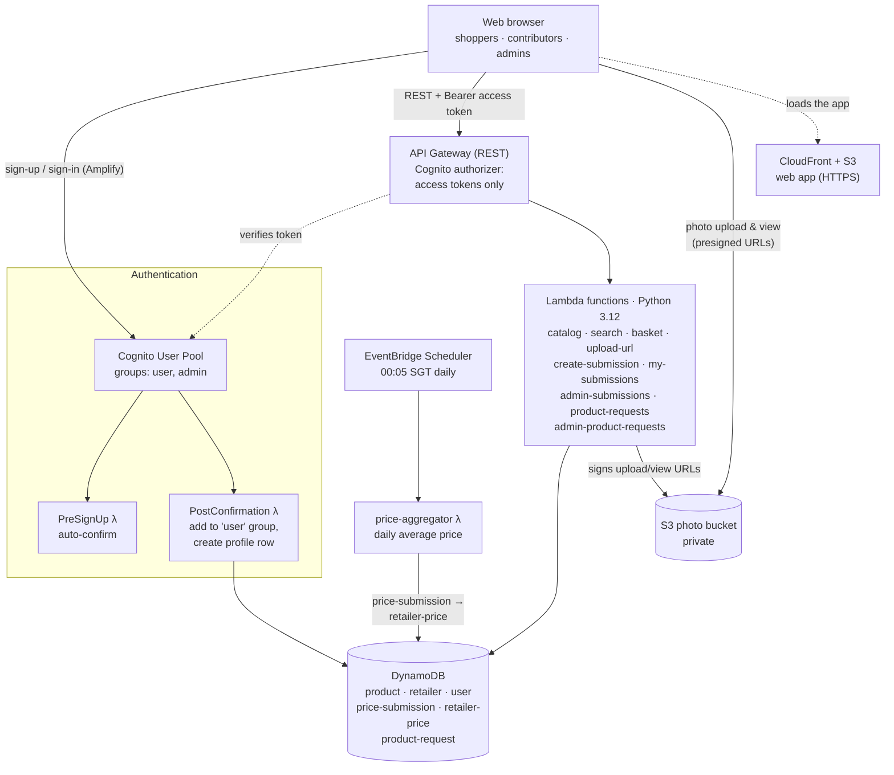
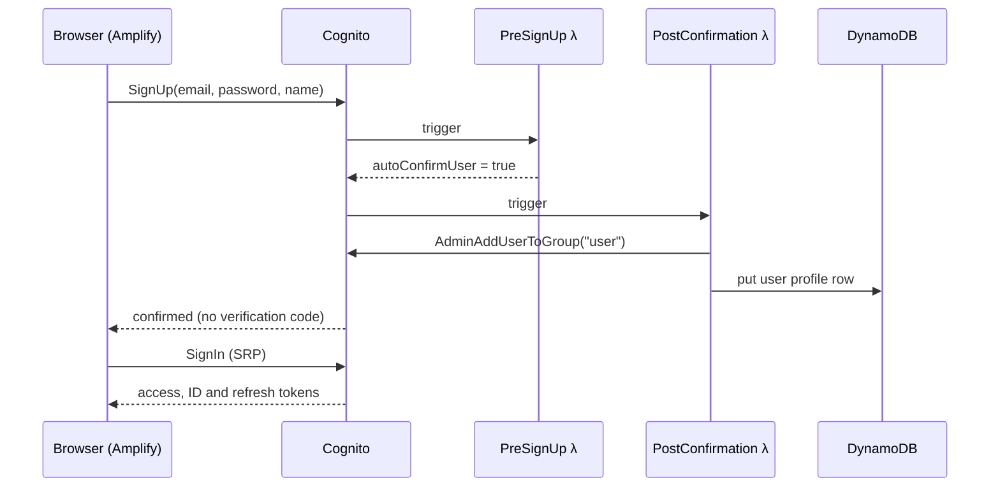
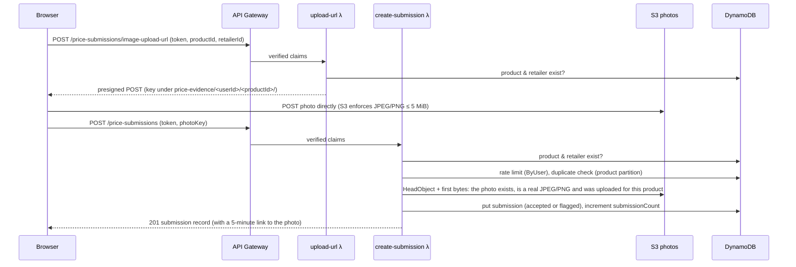
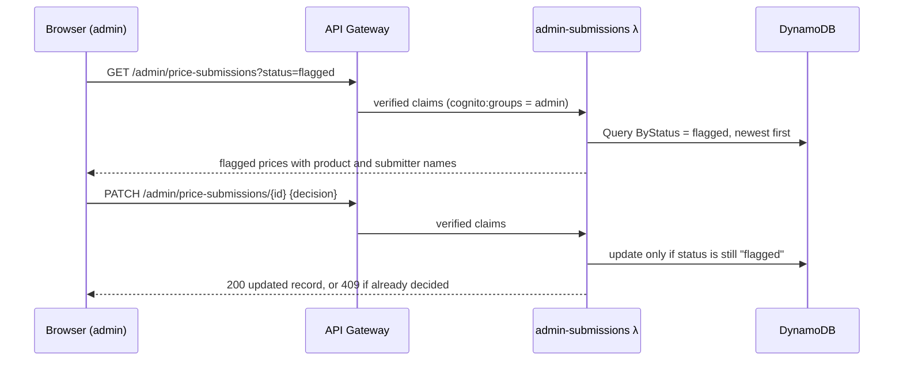
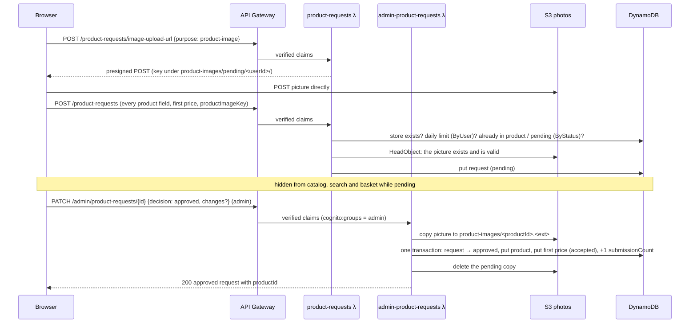
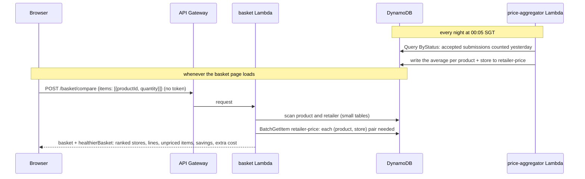
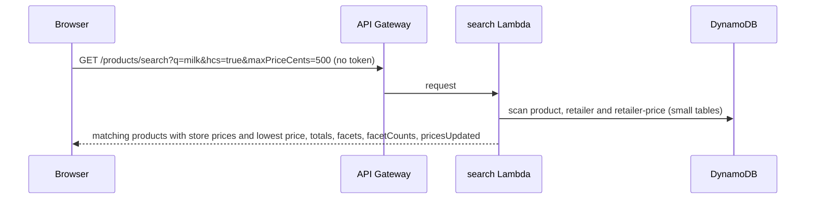

# TrolleySaver Architecture

**Status:** Current at the feature freeze · **Last updated:** 8 Nov 2026

How TrolleySaver's cloud components fit together. It builds on the Preliminary Report's architecture.

Related documents: the data model is in [database-design.md](database-design.md), the frontend/backend contract in the [API reference](../api/README.md), and the code, deployment and tests in [backend/README.md](../../backend/README.md).

Labels used below:
- **Built:** deployed and tested.
- **Decided:** agreed by the team but not built yet.
- **Proposed:** suggested and awaiting team agreement.

---

## 1. Overview

---

## 2. Components

| Component | Service | Role | Status |
|---|---|---|---|
| Frontend hosting | S3 + CloudFront | Serves the built React app over HTTPS from a private bucket (Origin Access Control), with a fallback to `index.html` for the app's own routes and the site's own security headers, including a Content-Security-Policy. Published by `infra/deploy.py`; see [deployment.md](../deployment.md). | Built |
| Auth | Cognito User Pool + 2 trigger Lambdas | Sign-up (confirmed automatically), sign-in, `user`/`admin` groups. The user id (`sub`) is attached to every submission. | Built |
| API | API Gateway (REST) | Routing, CORS, and a Cognito authorizer that accepts access tokens only | Built |
| Backend | Lambda | Catalog, product search, photo upload URLs, price submissions, new product requests, admin moderation, Smart Basket comparison | Built |
| Backend language | Python 3.12 on arm64 | Lambda runtime. Uses only the standard library and boto3. | Built |
| Database | DynamoDB, on-demand | 6 tables + 5 GSIs: product, retailer, user, price-submission, retailer-price (daily average price per product and store) and product-request (proposed products awaiting an admin). See [database-design.md](database-design.md). | Built |
| Scheduled jobs | EventBridge Scheduler | Runs `price-aggregator` at 00:05 SGT every day | Built |
| Photo storage | S3, private | Shelf-tag evidence photos (5-minute links, for admins and the contributor who took them) and product pictures (1-hour links on the catalog), uploaded and viewed only through presigned URLs | Built |
| Infrastructure as code | AWS SAM (`backend/template.yaml`) | One CloudFormation stack per environment, including the web app's hosting | Built |
| Deployment and CI | `infra/deploy.py`, GitHub Actions | One command tests, deploys the stack and publishes the web app. CI runs every test suite and the template lint on each push. See [deployment.md](../deployment.md). | Built |
| Cost guard | AWS Budgets alarm | Cap spend before stress testing | Proposed (Xinpeng) |
| Region | ap-southeast-1 | All users are in Singapore | Built |

### Lambda functions

Functions are named `trolleysaver-<env>-<name>`. All the code is in `backend/lambdas/`.

| Function | Triggered by | What it does |
|---|---|---|
| `catalog` | `GET /products`, `GET /retailers` (public) | Lists products (with a signed `imageUrl` for products that have a picture) and retailers |
| `search` | `GET /products/search` (public) | Filters the catalog and attaches each product's current store prices from `retailer-price`, and its `imageUrl` |
| `basket` | `POST /basket/compare` (public) | Prices a basket and its healthier version at every store from `retailer-price`, ranks the stores and works out savings |
| `price-aggregator` | EventBridge Scheduler, 00:05 SGT daily | Averages yesterday's accepted submissions per product and store into `retailer-price` |
| `upload-url` | `POST /price-submissions/image-upload-url` | Checks the product and store exist, then issues a presigned POST for one photo under `price-evidence/<userId>/<productId>/` (at most 60 upload links per user per hour) |
| `create-submission` | `POST /price-submissions` | Validates (product and store exist), rate-limits, allows one price per product and store a day, checks the photo is a real JPEG/PNG uploaded for this product, and saves the price as `accepted` or `flagged` |
| `my-submissions` | `GET /price-submissions/mine` | Lists the caller's own submissions, with 5-minute links to their own evidence photos |
| `delete-submission` | `DELETE /price-submissions/{id}` | Deletes one of the caller's own prices while it's still flagged (pending review), with its photo |
| `admin-submissions` | `GET` / `PATCH /admin/price-submissions` | Flagged queue with evidence-photo links, and accept/reject decisions (`admin` group only) |
| `product-requests` | `POST /product-requests/image-upload-url`, `POST /product-requests`, `GET /product-requests/mine`, `DELETE /product-requests/{id}` | Upload links for a new product's picture and evidence, proposing a product with its first price (all fields and a picture required, duplicates and a daily limit enforced), the caller's own requests, and deleting one of them while it's still pending |
| `admin-product-requests` | `GET` / `PATCH /admin/product-requests` | Pending queue, and approve (publish the product, its picture and first price in one transaction) or reject (`admin` group only) |
| `cognito-pre-signup` | Cognito PreSignUp | Checks the name and email the way the registration form does, then auto-confirms public sign-ups |
| `cognito-post-confirmation` | Cognito PostConfirmation | Adds the user to the `user` group and creates their profile row |

---

## 3. Key request flows

### 3.1 Sign-up and sign-in (Built)

- No client value decides a user's role: the server puts every public sign-up in the `user` group.
- Admin accounts are created with `backend/scripts/create_admin.py` by anyone with access to the AWS account, never through sign-up.

### 3.2 Contributor submits a price with an optional photo (Built)

- The photo goes **straight from the browser to S3**, so image bytes never pass through Lambda or DynamoDB.
- **The product is checked at both ends.** At the upload link, a photo can't even be uploaded for a product that doesn't exist. When the price is saved, the check covers price-only submissions, which skip the upload link, and direct calls.
- **Evidence photos** are seen by admins, who verify them, and by the contributor who took them, through 5-minute links. The browser redraws every photo before upload, which drops its metadata, including the GPS location phones record.
- **One price per contributor, product and store a day**, whatever the price. A rejected price frees the day. A contributor can delete their own price while it's still flagged.
- The price is `accepted` when it's within the product's `minCents`..`maxCents`, and `flagged` otherwise.

### 3.3 Admin moderates a flagged price (Built)

Moderation is **reactive**: admins only see prices that fall outside the believable range. Users flagging other users' prices is a possible future feature.

### 3.3a Contributor proposes a new product (Built)

- **Unapproved products stay out of the catalog.** Pending requests live in their own table, so the catalog, search and basket never see them, and none of that code had to change.
- **The transaction makes approval all-or-nothing:**
  - two admins approving at once publish the product only once; the second gets `409`
  - if the transaction fails, the copied picture is removed
- The first price counts in the daily average of the day it was approved.

### 3.4 Shopper plans a basket (Built)

- **Prices:** each store's price for a product is the **daily average** stored in `retailer-price` (rules in [database-design.md §4](database-design.md#4-daily-average-price-retailer-price)).
  - `price-aggregator` averages the accepted submissions that entered the system during the previous Singapore day, separately for each product and store. Pairs with no new submissions keep their last average.
  - The basket (`common/pricing.py` `prices_by_key`) fetches only the rows it needs, by key: every basket product and Healthier Choice candidate at every chosen store, up to 100 keys per BatchGetItem. It ignores averages more than 30 days old (`PRICE_MAX_AGE_DAYS`).
  - New prices reach the basket after the next nightly run, and the response's `pricesUpdated` says when that was: the newest `priceUpdatedAt` in the catalogue, which the job sets on each product it prices.
- **Comparison:** `common/basket.py` totals the basket at every store and lists unpriced items. It ranks stores that price everything first, cheapest first, and compares the cheapest with each other store, over the full basket or only the items both price.
- **Healthier basket:** `common/healthier.py` swaps each product for the cheapest Healthier Choice product in its category at each store, where one exists. The same comparison then runs on the swapped basket, and the extra cost against the original is reported.
- The Lambda is stateless and public. The frontend keeps the basket.
- Promotions, member prices and multi-buy deals are not tracked. Prices are per retailer, not per branch.

### 3.5 Shopper searches for products (Built)

- **Filters:** `common/search.py` keeps products that match every filter given. `q` must match every word, ignoring case, in the name, brand, category, search terms, dietary tags or pack size. `category`, `brand`, `dietary` and `hcs` match exactly, ignoring case. With no filters it returns the whole catalog.
- **Prices:** the same daily averages as the basket (§3.4), read by `common/pricing.py`, with averages more than 30 days old left out. The price filter uses each product's lowest current price at any store, so products with no current price drop out when a price bound is set.
- **Facets:** `facets` lists every category, brand and dietary tag in the catalog. `facetCounts` says how many products each option would give with the other filters applied, so the dropdowns only offer options that lead somewhere.
- Every match is returned, with no pagination. This is fine at the catalog's current size.

---

## 4. Environments

| Environment | Stack | Tables | Purpose | Status |
|---|---|---|---|---|
| dev | `trolleysaver-dev` | The existing hand-made `trolleysaver-dev-*` tables (`CreateTables=false`) | Frontend integration, backend testing and day-to-day development | Built |
| staging | — | — | Integration and QA stress testing | Not created |
| prod | — | — | User evaluation and final demo | Not created |

- Each stack has its own Cognito user pool, API URL, Lambda functions and photo bucket. Accounts don't carry over between environments.
- Deploy with `python infra\deploy.py` from the repository root. It runs `sam deploy` for the stack and publishes the web app ([deployment.md](../deployment.md)).
- A new environment needs a new section in `backend/samconfig.toml`, with `CreateTables=true` so the stack creates its own tables.
- A temporary `test` stack with its own tables was used to build and verify the backend before switching to the dev tables. It was deleted on 24 Oct 2026.

---

## 5. Security and abuse prevention

**Built:**
- **Every write needs a Cognito login.** API Gateway rejects missing, invalid, expired and ID tokens before any Lambda runs.
- **Identity comes from the verified token** (`sub`), never from the request body. Roles come from `cognito:groups`, and admin routes check for `admin` in the Lambda.
- **Users can't choose their own role.** The `user` group is assigned by a trigger, and admins are created by script.
- **The photo bucket is private:** public access is blocked, the bucket owner owns every object, data is encrypted at rest (SSE-S3), and a bucket policy denies plain HTTP. Images are only reachable through presigned URLs:
  - evidence photos: 5 minutes, for admins and the contributor who took them
  - product pictures: 1 hour

  A user can only upload under their own folders (`price-evidence/<their userId>/…`, `product-images/pending/<their userId>/`).
- **Uploads are limited** to JPEG/PNG of 5 MiB or less. The presigned POST policy enforces this, and it's checked again before a submission or product request can reference an image. The backend also checks each file's first bytes really are a JPEG or PNG, and deletes it if not. The browser redraws every photo before upload, so no metadata (such as GPS location) is stored.
- **Evidence photos are tied to a product.** An upload link is only issued for an existing product and store, and a photo can only be attached to a price for that same product.
- **Rate limits:** per user, 30 submissions an hour, 10 product requests a day and 60 photo upload links an hour. For the whole API, 20 requests a second with bursts of 40. One price per user, product and store a day, and duplicate products are refused.
- **Bad data is flagged, not trusted:**
  - out-of-range prices wait for an admin, and only `accepted` prices count
  - new products wait for an admin before anyone sees them
- **Least-privilege IAM:** each Lambda can only use the tables and bucket prefix it needs.
- **CORS** only allows the local dev server (`http://localhost:5173`) and the deployed site (the CloudFront URL): API responses name the caller's origin only when it's one of those, and the photo bucket accepts uploads only from them ([deployment.md §5](../deployment.md#5-cors-which-sites-may-call-the-api)).
- **The web site sends security headers**, including a Content-Security-Policy that only allows the app's own code and the API, Cognito and photo bucket ([deployment.md → Security headers](../deployment.md#security-headers)).
- **Text can't hide anything:** names, brands, categories, tags, search terms and reasons refuse control and invisible characters. The sign-up trigger applies the registration form's name rules.
- **Backups:** tables the template creates have point-in-time recovery. Dev's hand-made tables don't have it yet ([deployment.md §8](../deployment.md#8-known-limitations)).

**Not built** (listed with reasons in [deployment.md §8](../deployment.md#8-known-limitations)):
- Scanning image content beyond checking it's a real JPEG/PNG
- Cleaning up uploads that are never used in a submission or product request (the upload-link limit caps them)
- Per-visitor rate limiting with AWS WAF; the API throttle is shared by everyone

---

## 6. Cost notes (for the cloud vs. on-premise comparison)

- **Idle cost is near zero.** Everything is serverless and on-demand, so with no traffic the only costs are S3 and DynamoDB storage, both tiny at PoC size. Cognito use stays well inside its free monthly active users at this scale.
- **Per-request DynamoDB and S3 usage:**

| Request | Calls |
|---|---|
| Price submission | 2 GetItem, 2 Query (rate limit, duplicate), 1 S3 HeadObject + 1 ranged GetObject (with a photo), 1 PutItem, 1 UpdateItem |
| Deleting a pending price | 1 GetItem, 1 DeleteItem, 1 UpdateItem, 1 S3 DeleteObject (with a photo) |
| "My submissions" page | 1 Query + 2 BatchGetItem |
| Photo upload | 1 Lambda call to sign (2 GetItem to check the product and store, 1 UpdateItem to count the link), then 1 direct S3 upload |
| Product request | 1 GetItem, 1 Query (daily limit), 1 Scan of `product` + 1 Query of pending requests (duplicates), 1–2 S3 HeadObject, 1 PutItem |
| Product approval | 1 GetItem, 1 Scan of `product` (duplicates), 1 S3 copy + 1 delete, 1 transaction of 4 writes |
| Product search | 3 Scans (product, retailer and retailer-price tables) |
| Basket comparison | 2 Scans (product and retailer, 27 small items) + ⌈(N + C) × M / 100⌉ BatchGetItem on retailer-price, for N basket products, C Healthier Choice candidates and M chosen stores (1 call for most baskets) |
| Nightly daily-price job | 1 Query on `ByStatus` (accepted submissions) + 1 BatchWrite per 25 updated prices, once a day |

- **Lambda functions use 256 MB on arm64** (cheaper per millisecond than x86), and typical calls take well under a second.
- **Before stress testing**, set an AWS Budgets alarm on the account.
