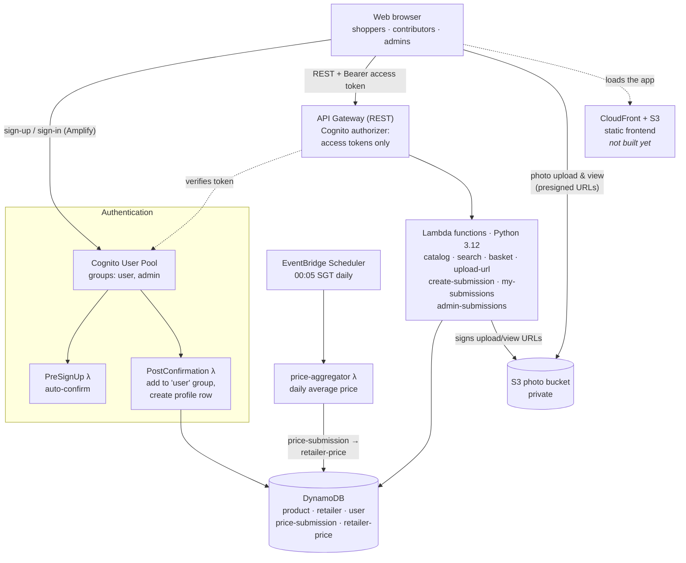
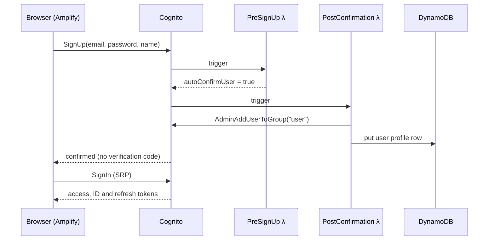
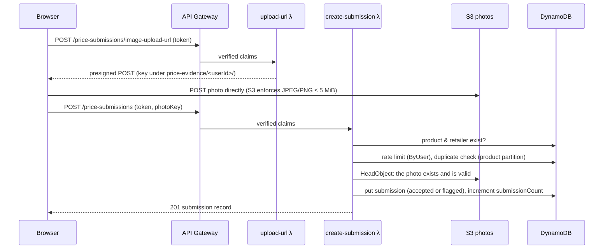
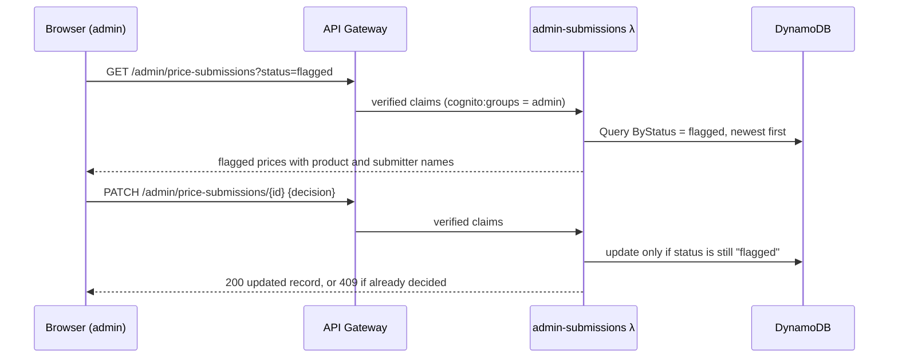
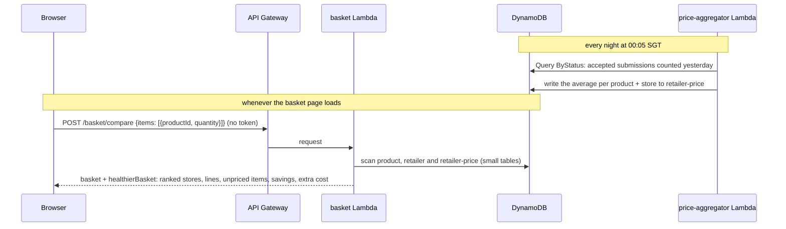
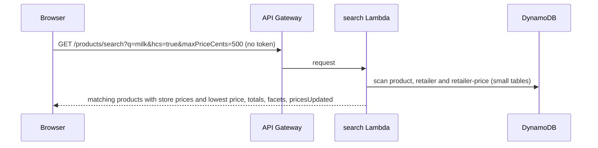

# TrolleySaver Architecture

**Status:** Draft · **Last updated:** 25 Oct 2026

How TrolleySaver's cloud components fit together. It builds on the Preliminary Report's architecture.

Related documents: the data model is in [database-design.md](database-design.md), the frontend/backend contract in the [API reference](../api/README.md), and the code, deployment and tests in [backend/README.md](../../backend/README.md).

Labels used below:
- **Built:** deployed and tested.
- **Decided:** agreed by the team but not built yet.
- **Proposed:** suggested and awaiting team agreement.

---

## 1. Overview

---

## 2. Components

| Component | Service | Role | Status |
|---|---|---|---|
| Frontend hosting | S3 + CloudFront | Serves the built React app via CDN | Decided (the frontend runs locally for now) |
| Auth | Cognito User Pool + 2 trigger Lambdas | Sign-up (confirmed automatically), sign-in, `user`/`admin` groups. The user id (`sub`) is attached to every submission. | Built |
| API | API Gateway (REST) | Routing, CORS, and a Cognito authorizer that accepts access tokens only | Built |
| Backend | Lambda | Catalog, product search, photo upload URLs, price submissions, admin moderation, Smart Basket comparison | Built |
| Backend language | Python 3.12 on arm64 | Lambda runtime. Uses only the standard library and boto3. | Built |
| Database | DynamoDB, on-demand | 5 tables + 3 GSIs: product, retailer, user, price-submission, and retailer-price (daily average price per product and store). See [database-design.md](database-design.md). | Built |
| Scheduled jobs | EventBridge Scheduler | Runs `price-aggregator` at 00:05 SGT every day | Built |
| Photo storage | S3, private | Shelf-tag photos, uploaded and viewed only through 5-minute presigned URLs | Built |
| Infrastructure as code | AWS SAM (`backend/template.yaml`) | One CloudFormation stack per environment | Built |
| Cost guard | AWS Budgets alarm | Cap spend before stress testing | Proposed (Xinpeng) |
| Region | ap-southeast-1 | All users are in Singapore | Built |

### Lambda functions

Functions are named `trolleysaver-<env>-<name>`. All the code is in `backend/lambdas/`.

| Function | Triggered by | What it does |
|---|---|---|
| `catalog` | `GET /products`, `GET /retailers` (public) | Lists products and retailers |
| `search` | `GET /products/search` (public) | Filters the catalog and attaches each product's current store prices from `retailer-price` |
| `basket` | `POST /basket/compare` (public) | Prices a basket and its healthier version at every store from `retailer-price`, ranks the stores and works out savings |
| `price-aggregator` | EventBridge Scheduler, 00:05 SGT daily | Averages yesterday's accepted submissions per product and store into `retailer-price` |
| `upload-url` | `POST /price-submissions/image-upload-url` | Issues a presigned POST for one photo under `price-evidence/<userId>/` |
| `create-submission` | `POST /price-submissions` | Validates, rate-limits, rejects duplicates, checks the photo, and saves the price as `accepted` or `flagged` |
| `my-submissions` | `GET /price-submissions/mine` | Lists the caller's own submissions |
| `admin-submissions` | `GET` / `PATCH /admin/price-submissions` | Flagged queue and accept/reject decisions (`admin` group only) |
| `cognito-pre-signup` | Cognito PreSignUp | Auto-confirms public sign-ups |
| `cognito-post-confirmation` | Cognito PostConfirmation | Adds the user to the `user` group and creates their profile row |

---

## 3. Key request flows

### 3.1 Sign-up and sign-in (Built)

- No client value decides a user's role: the server puts every public sign-up in the `user` group.
- Admin accounts are created with `backend/scripts/create_admin.py` by anyone with access to the AWS account, never through sign-up.

### 3.2 Contributor submits a price with an optional photo (Built)

- The photo goes **straight from the browser to S3**, so image bytes never pass through Lambda or DynamoDB.
- The price is `accepted` when it's within the product's `minCents`..`maxCents`, and `flagged` otherwise.

### 3.3 Admin moderates a flagged price (Built)

Moderation is **reactive**: admins only see prices that fall outside the believable range. Users flagging other users' prices is a possible future feature.

### 3.4 Shopper plans a basket

- **Prices:** each store's price for a product is the **daily average** stored in `retailer-price` (rules in [database-design.md §4](database-design.md#4-daily-average-price-retailer-price)).
  - `price-aggregator` averages the accepted submissions that entered the system during the previous Singapore day, separately for each product and store. Pairs with no new submissions keep their last average.
  - The basket (`common/pricing.py`) ignores averages more than 30 days old (`PRICE_MAX_AGE_DAYS`).
  - New prices reach the basket after the next nightly run, and the response's `pricesUpdated` says when that was.
- **Comparison:** `common/basket.py` totals the basket at every store and lists unpriced items. It ranks stores that price everything first, cheapest first, and compares the cheapest with each other store, over the full basket or only the items both price.
- **Healthier basket:** `common/healthier.py` swaps each product for the cheapest Healthier Choice product in its category at each store, where one exists. The same comparison then runs on the swapped basket, and the extra cost against the original is reported.
- The Lambda is stateless and public. The frontend keeps the basket.
- Promotions, member prices and multi-buy deals are not tracked. Prices are per retailer, not per branch.

### 3.5 Shopper searches for products

- **Filters:** `common/search.py` keeps products that match every filter given. `q` must match every word, ignoring case, in the name, brand, category, search terms, dietary tags or pack size. `category`, `brand`, `dietary` and `hcs` match exactly, ignoring case. With no filters it returns the whole catalog.
- **Prices:** the same daily averages as the basket (§3.4), read by `common/pricing.py`, with averages more than 30 days old left out. The price filter uses each product's lowest current price at any store, so products with no current price drop out when a price bound is set.
- **Facets** (categories, brands, dietary tags) come from the whole catalog, so the page's filter options don't shrink as filters apply.
- Every match is returned, with no pagination. This is fine at the catalog's current size.

---

## 4. Environments

| Environment | Stack | Tables | Purpose | Status |
|---|---|---|---|---|
| dev | `trolleysaver-dev` | The existing hand-made `trolleysaver-dev-*` tables (`CreateTables=false`) | Frontend integration, backend testing and day-to-day development | Built |
| staging | — | — | Integration and QA stress testing | Not created |
| prod | — | — | User evaluation and final demo | Not created |

- Each stack has its own Cognito user pool, API URL, Lambda functions and photo bucket. Accounts don't carry over between environments.
- Deploy from `backend/` with `sam deploy --config-env dev`.
- A new environment needs a new section in `backend/samconfig.toml`, with `CreateTables=true` so the stack creates its own tables.
- A temporary `test` stack with its own tables was used to build and verify the backend before switching to the dev tables. It was deleted on 24 Oct 2026.

---

## 5. Security and abuse prevention

**Built:**
- **Every write needs a Cognito login.** API Gateway rejects missing, invalid, expired and ID tokens before any Lambda runs.
- **Identity comes from the verified token** (`sub`), never from the request body. Roles come from `cognito:groups`, and admin routes check for `admin` in the Lambda.
- **Users can't choose their own role.** The `user` group is assigned by a trigger, and admins are created by script.
- **The photo bucket is private:** public access is blocked, the bucket owner owns every object, data is encrypted at rest (SSE-S3), and a bucket policy denies plain HTTP. Photos are only reachable through 5-minute presigned URLs, and a user can only upload under `price-evidence/<their userId>/`.
- **Uploads are limited** to JPEG/PNG of 5 MiB or less. The presigned POST policy enforces this, and it's checked again before a submission can reference a photo.
- **Per-user rate limit** of 30 submissions per hour. Duplicate submissions are refused.
- **Bad data is flagged, not trusted.** Out-of-range prices wait for an admin, and only `accepted` prices count.
- **Least-privilege IAM:** each Lambda can only use the tables and bucket prefix it needs.
- **CORS** only allows the frontend origin (`http://localhost:5173` for now).

**Proposed:**
- Scanning image content
- Cleaning up uploads that are never used in a submission
- API throttling limits or AWS WAF before public launch

---

## 6. Cost notes (for the cloud vs. on-premise comparison)

- **Idle cost is near zero.** Everything is serverless and on-demand, so with no traffic the only costs are S3 and DynamoDB storage, both tiny at PoC size. Cognito use stays well inside its free monthly active users at this scale.
- **Per-request DynamoDB and S3 usage:**

| Request | Calls |
|---|---|
| Price submission | 2 GetItem, 2 Query (rate limit, duplicate), 1 S3 HeadObject (with a photo), 1 PutItem, 1 UpdateItem |
| "My submissions" page | 1 Query + 2 BatchGetItem |
| Photo upload | 1 Lambda call to sign, then 1 direct S3 upload |
| Product search | 3 Scans (product, retailer and retailer-price tables) |
| Basket comparison | 3 Scans (product, retailer and retailer-price tables, about 100 small items in all) |
| Nightly daily-price job | 1 Query on `ByStatus` (accepted submissions) + 1 BatchWrite per 25 updated prices, once a day |

- **Lambda functions use 256 MB on arm64** (cheaper per millisecond than x86), and typical calls take well under a second.
- **Before stress testing**, set an AWS Budgets alarm on the account.
