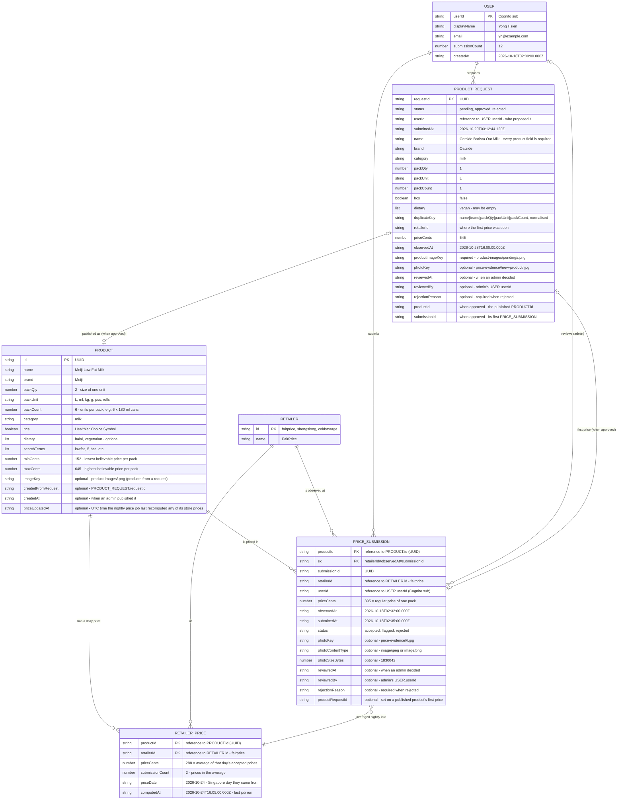
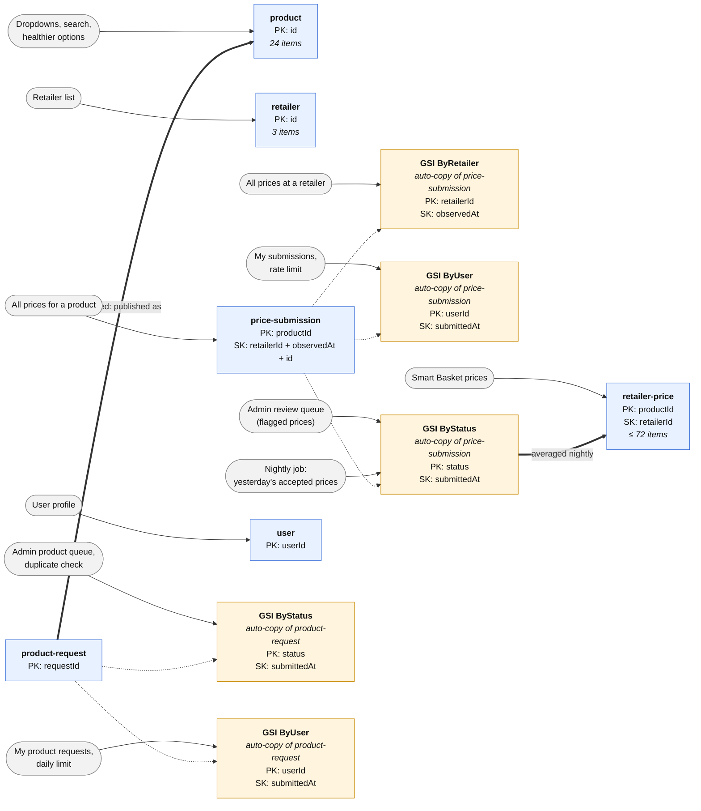
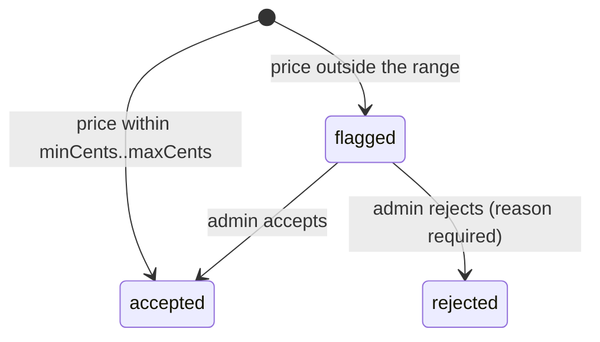
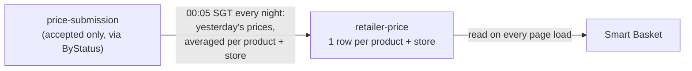
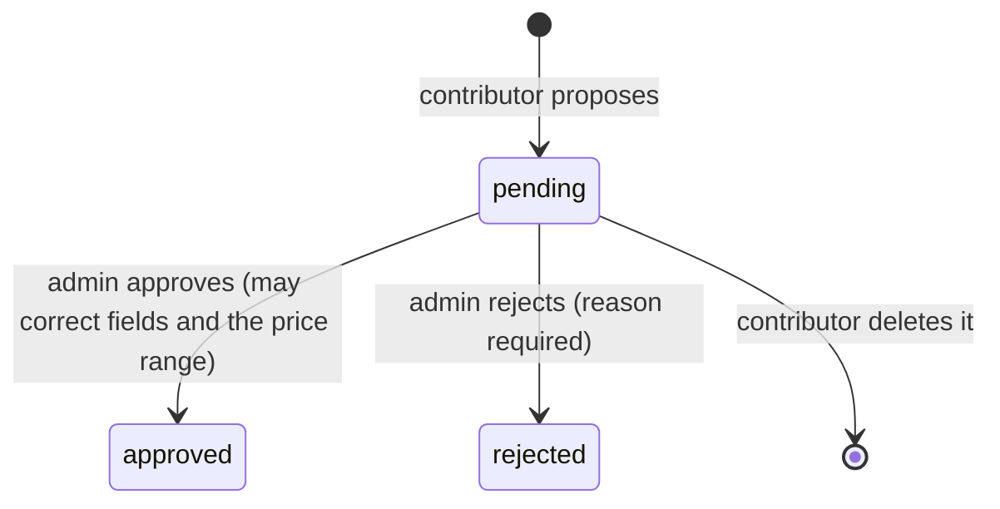

# TrolleySaver Database Design (Draft)

**Owner:** Yong Hsien · **Last updated:** 29 Oct 2026 · **Database:** Amazon DynamoDB

## 1. Entity Relationship Diagram

## 2. DynamoDB Tables and Indexes

There are **6 tables**, one per entity, named `trolleysaver-<env>-<entity>` (e.g. `trolleysaver-dev-price-submission`):
- `product`, `retailer` and `user` hold reference data. `product` only ever holds **published** products.
- `price-submission` holds every price a contributor (or the seed) reported.
- `retailer-price` holds the **one price per product and store** that the Smart Basket uses. It is derived from `price-submission` by a nightly job (section 4).
- `product-request` holds products contributors have proposed, until an admin approves or rejects them (section 5). Keeping them out of `product` means the catalog, search and basket never see an unapproved product.

**Notes:**
- **Regular shelf prices only.** Promotions, member prices and multi-buy deals are not tracked. There are no price-type, offer-condition or offer-end-date fields, and promo rows in the data spreadsheet are not loaded.
- Prices are recorded per retailer (FairPrice, Sheng Siong, Cold Storage), not per branch. Retailer ids are `fairprice`, `shengsiong` and `coldstorage`.
- Prices are in cents (`395` = $3.95). Timestamps are UTC ISO 8601 with milliseconds.

## 3. Price status and moderation

Moderation is **reactive**: admins only look at prices that look wrong.

- On submission, the backend compares `priceCents` with the product's `minCents`/`maxCents`. In-range prices are saved as `accepted` and can be used straight away. Out-of-range prices are saved as `flagged`.
- Admins (Cognito group `admin`) list flagged prices through the `ByStatus` index and move each one to `accepted` or `rejected`. A decision can only be made once, and a second admin decision is refused.
- Only `accepted` prices should be used for search, comparison and the smart basket. `flagged` and `rejected` prices are ignored.
- Letting users flag each other's submissions is a possible future feature and is not part of this design.

## 4. Daily average price (`retailer-price`)

A price belongs to a (product, retailer) pair, so it can't be stored on the product. The Smart Basket reads one price per pair from `retailer-price`, which a scheduled Lambda (`price-aggregator`) rebuilds every night.

| Rule | Detail |
|---|---|
| **Which prices** | Accepted submissions that **entered the system during the previous Singapore day** (00:00–24:00 SGT), whatever date they were observed. A flagged price an admin accepts counts on the day it was accepted (`reviewedAt`). Flagged and rejected prices never count. |
| **Per pair** | Averaged separately for each product **and** store. A store's price only comes from submissions for that store. |
| **Average** | The mean, rounded to the nearest cent, halves up. Example: eggs at Cold Storage on 24 Oct, (375 + 500) / 2 = **438**. `submissionCount` says how many prices went in. |
| **No submissions that day** | The row isn't touched, so the pair keeps its last average and its `priceDate`. |
| **Stale** | The basket ignores a row whose `priceDate` is more than 30 days old (`PRICE_MAX_AGE_DAYS`), and shows the product as unpriced at that store. |
| **When** | 00:05 SGT daily (EventBridge Scheduler). A price submitted today reaches the basket after tonight's run. The job can also be run for one date, or to backfill the last N days. |
| **Product timestamp** | Each product whose price changed at any store gets `priceUpdatedAt` set to the run's `computedAt` (UTC). It isn't touched when nothing new came in, and a deleted product is never recreated. `GET /products` returns it, as `null` for a product never priced. A one-off `syncProductTimestamps` run fills it in from the newest `computedAt` in `retailer-price`. |

The table is small (at most products × stores rows, 72 today), so the basket reads it whole on each request.

## 5. New products (`product-request`)

A contributor who can't find a product proposes it with **every product field**, its first price (store, price, observed date), a **required picture** and an optional evidence photo. An admin decides.

- **Pending requests are invisible to shoppers.** They live only in `product-request`.
- **Approval publishes everything in one DynamoDB transaction:**
  - the request becomes `approved`
  - a new `product` row is created, with `minCents` / `maxCents` defaulting to half to one and a half times the first price, unless the admin sets them
  - the first price is saved as an `accepted` `price-submission`, with `reviewedAt` set to the approval time so the nightly job counts it that day
  - the contributor's `submissionCount` goes up by one

  The product's picture is moved from `product-images/pending/…` to `product-images/<productId>.<ext>`, and the product's `imageKey` points at it.
- **Rejection** keeps the request with its reason and deletes the pending picture.
- **Deletion:** while a request is still pending, its contributor can delete it. The row is removed, along with its pending picture and evidence photo. Approved and rejected requests can't be deleted. A deleted request no longer counts toward the daily limit.
- **Duplicates are refused:**
  - a request for a product already in `product`, matched on normalised name, brand, pack size and units per pack (`duplicateKey`; a missing `packCount` counts as 1, so 6 × 1 L is not a duplicate of 1 L)
  - a request matching one that is already pending
  - an approval if the product appeared in the meantime
- **Limit:** 10 product requests per user per 24 hours, counted with `ByUser`.

## 6. Images in S3

All images are in the private photo bucket `trolleysaver-<env>-photos-<account>` and are only reachable through short-lived signed links.

| Folder | What | Who can view it |
|---|---|---|
| `price-evidence/<userId>/<productId>/<uuid>.<ext>` | Shelf-tag photo proving a price of an existing product | Admins only (5-minute link) |
| `price-evidence/<userId>/new-product/<uuid>.<ext>` | The same, for the first price of a product request | Admins only (5-minute link) |
| `product-images/pending/<userId>/<uuid>.<ext>` | A product request's picture until an admin decides | The contributor and admins (1-hour link) |
| `product-images/<productId>.<ext>` | A published product's picture | Everyone, through `imageUrl` on the catalog and search (1-hour link) |

## 7. Other rules enforced by the backend

- `productId` and `retailerId` must exist before an evidence upload link is given, and again before a submission is saved (price-only submissions never ask for a link).
- Rate limit: 30 submissions per user per hour, counted with the `ByUser` index.
- Duplicates: one price per user, product and retailer per Singapore calendar day (the observed date), whatever the price. A rejected or deleted price doesn't count.
- Withdrawing: a contributor can delete their own price only while it's `flagged` (pending review). The row and its photo are removed, and `submissionCount` goes down by one.
- `observedAt` cannot be in the future or more than 30 days old.
- `photoKey` must point at an object the same user uploaded **for that product** (`price-evidence/<userId>/<productId>/…`), which must be a JPEG or PNG of at most 5 MiB. Photos uploaded before 29 Oct 2026 sit at `price-evidence/<userId>/<uuid>`; they stay attached to their submissions, but can't be attached to new ones.
- The `user` row is created at sign-up. `submissionCount` goes up by one with each submission.
- Seed prices loaded from the data spreadsheet use `userId = "seed-team"` and `status = "accepted"`.

## Abbreviations

| Abbreviation | Meaning |
| --- | --- |
| PK | Primary key. In the ER diagram it marks the fields that make up a record's key. In the DynamoDB diagram it means **partition key**, the field that groups records together |
| SK / `sk` | Sort key: orders records within a partition and keeps each one unique. In `price-submission`, `sk` = `retailerId#observedAt#submissionId`; in `retailer-price` the sort key is `retailerId` |
| SGT | Singapore time (UTC+8). Days in the daily price run midnight to midnight SGT |
| Reference | Not an abbreviation, but worth noting: a field that stores another item's id (e.g. `retailerId` → RETAILER). DynamoDB has no foreign keys or joins, so nothing enforces these links; the backend checks the id exists before saving |
| GSI | Global Secondary Index: an automatically kept copy of a table, organised by a different key so it can be searched another way |
| HCS / `hcs` | Healthier Choice Symbol: the Health Promotion Board label for healthier products |
| UUID | Universally Unique Identifier: a randomly generated id, e.g. `9f1c2b7e-…` |
| S3 | Amazon Simple Storage Service: where shelf-tag photos and product pictures are stored (section 6) |
| L, ml, kg, g, pcs | Litres, millilitres, kilograms, grams, pieces (`packUnit` values) |
