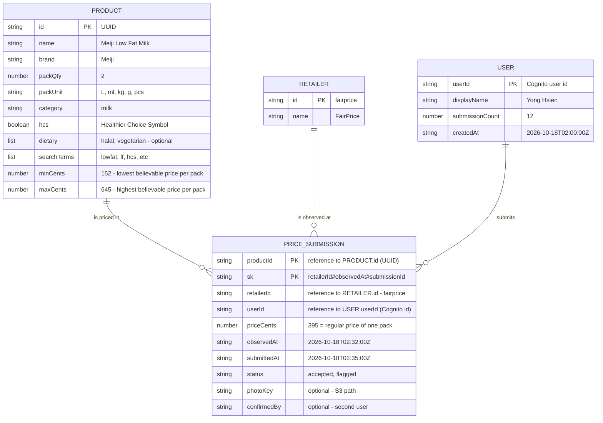
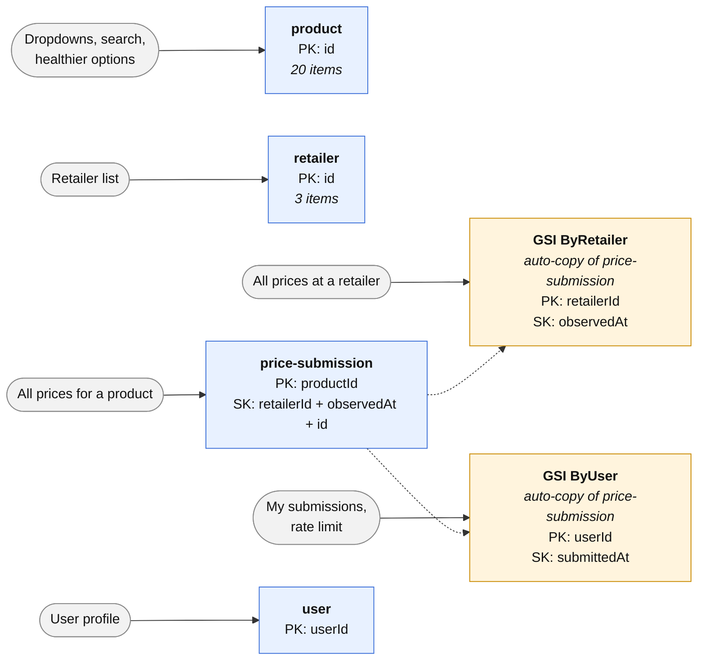

# TrolleySaver Database Design (Draft)

**Owner:** Yong Hsien · **Last updated:** 22 Oct 2026 · **Database:** Amazon DynamoDB

## 1. Entity Relationship Diagram

## 2. DynamoDB Tables and Indexes

One table per entity, named `trolleysaver-<env>-<entity>` (e.g. `trolleysaver-dev-price-submission`).

**Notes:** MVP stores **regular shelf prices only** (no promotions, member prices or multi-buy deals) · prices are recorded per retailer (FairPrice, Sheng Siong, Cold Storage), not per branch · prices are in cents (`395` = $3.95) · `flagged` prices are ignored until a second user submits the same price.

## Abbreviations

| Abbreviation | Meaning |
| --- | --- |
| PK | Primary key. In the ER diagram it marks the fields that make up a record's key. In the DynamoDB diagram it means **partition key**, the field that groups records together |
| SK / `sk` | Sort key: orders records within a partition and keeps each one unique. In `price-submission`, `sk` = `retailerId#observedAt#submissionId` |
| Reference | Not an abbreviation, but worth noting: a field that stores another item's id (e.g. `retailerId` → RETAILER). DynamoDB has no foreign keys or joins, so nothing enforces these links; the backend checks the id exists before saving |
| GSI | Global Secondary Index: an automatically kept copy of a table, organised by a different key so it can be searched another way |
| HCS / `hcs` | Healthier Choice Symbol: the Health Promotion Board label for healthier products |
| UUID | Universally Unique Identifier: a randomly generated id, e.g. `9f1c2b7e-…` |
| S3 | Amazon Simple Storage Service: where shelf-tag photos are stored |
| L, ml, kg, g, pcs | Litres, millilitres, kilograms, grams, pieces (`packUnit` values) |
