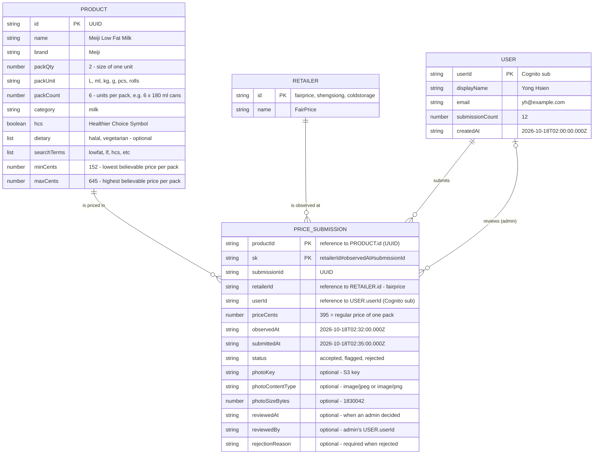
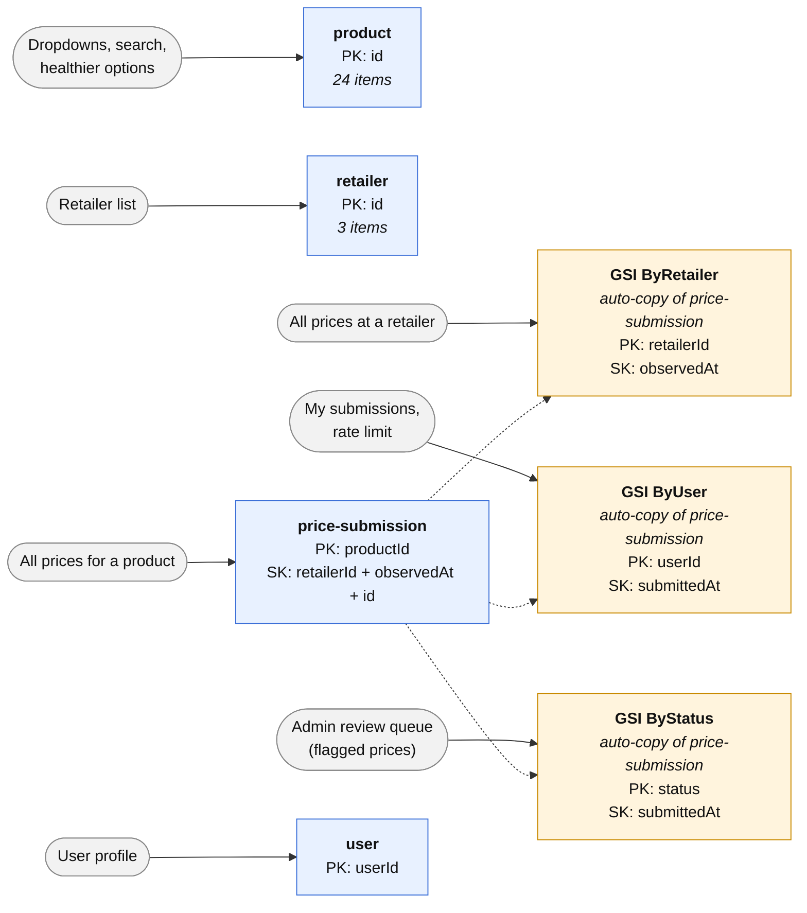
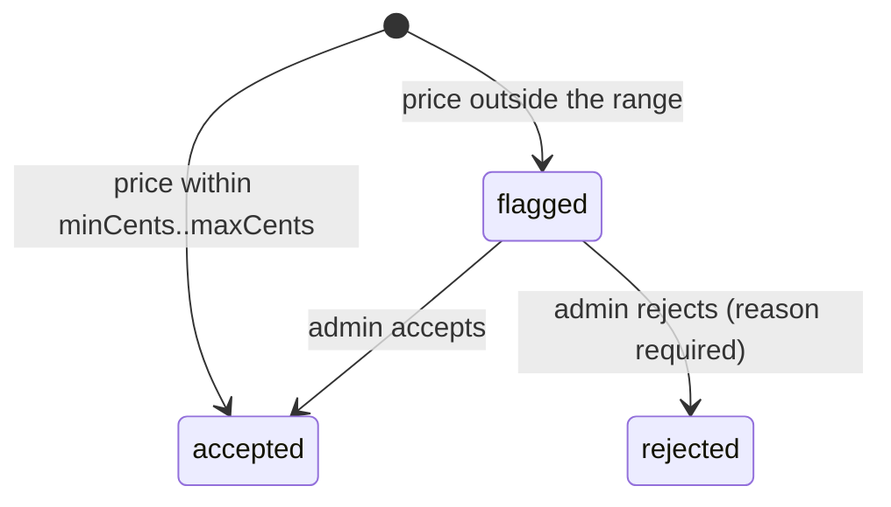

# TrolleySaver Database Design (Draft)

**Owner:** Yong Hsien · **Last updated:** 24 Oct 2026 · **Database:** Amazon DynamoDB

## 1. Entity Relationship Diagram

## 2. DynamoDB Tables and Indexes

One table per entity, named `trolleysaver-<env>-<entity>` (e.g. `trolleysaver-dev-price-submission`).

**Notes:**
- **Regular shelf prices only.** Promotions, member prices and multi-buy deals are not tracked. There are no price-type, offer-condition or offer-end-date fields, and promo rows in the data spreadsheet are not loaded.
- Prices are recorded per retailer (FairPrice, Sheng Siong, Cold Storage), not per branch. Retailer ids are `fairprice`, `shengsiong` and `coldstorage`.
- Prices are in cents (`395` = $3.95). Timestamps are UTC ISO 8601 with milliseconds.

## 3. Price status and moderation

Moderation is **reactive**: admins only look at prices that look wrong.

- On submission, the backend compares `priceCents` with the product's `minCents`/`maxCents`. In-range prices are saved as `accepted` and can be used straight away. Out-of-range prices are saved as `flagged`.
- Admins (Cognito group `admin`) list flagged prices through the `ByStatus` index and move each one to `accepted` or `rejected`. A decision can only be made once, and a second admin decision is refused.
- Only `accepted` prices should be used for search, comparison and the smart basket. `flagged` and `rejected` prices are ignored.
- Letting users flag each other's submissions is a possible future feature and is not part of this design.

## 4. Other rules enforced by the backend

- `productId` and `retailerId` must exist before a submission is saved.
- Rate limit: 30 submissions per user per hour, counted with the `ByUser` index.
- Duplicates: the same user, product, retailer and price on the same Singapore calendar day is refused.
- `observedAt` cannot be in the future or more than 30 days old.
- `photoKey` must point at an object the same user uploaded (`price-evidence/<userId>/…`), which must be a JPEG or PNG of at most 5 MiB.
- The `user` row is created at sign-up. `submissionCount` goes up by one with each submission.
- Seed prices loaded from the data spreadsheet use `userId = "seed-team"` and `status = "accepted"`.

## Abbreviations

| Abbreviation | Meaning |
| --- | --- |
| PK | Primary key. In the ER diagram it marks the fields that make up a record's key. In the DynamoDB diagram it means **partition key**, the field that groups records together |
| SK / `sk` | Sort key: orders records within a partition and keeps each one unique. In `price-submission`, `sk` = `retailerId#observedAt#submissionId` |
| Reference | Not an abbreviation, but worth noting: a field that stores another item's id (e.g. `retailerId` → RETAILER). DynamoDB has no foreign keys or joins, so nothing enforces these links; the backend checks the id exists before saving |
| GSI | Global Secondary Index: an automatically kept copy of a table, organised by a different key so it can be searched another way |
| HCS / `hcs` | Healthier Choice Symbol: the Health Promotion Board label for healthier products |
| UUID | Universally Unique Identifier: a randomly generated id, e.g. `9f1c2b7e-…` |
| S3 | Amazon Simple Storage Service: where shelf-tag photos are stored |
| L, ml, kg, g, pcs | Litres, millilitres, kilograms, grams, pieces (`packUnit` values) |
