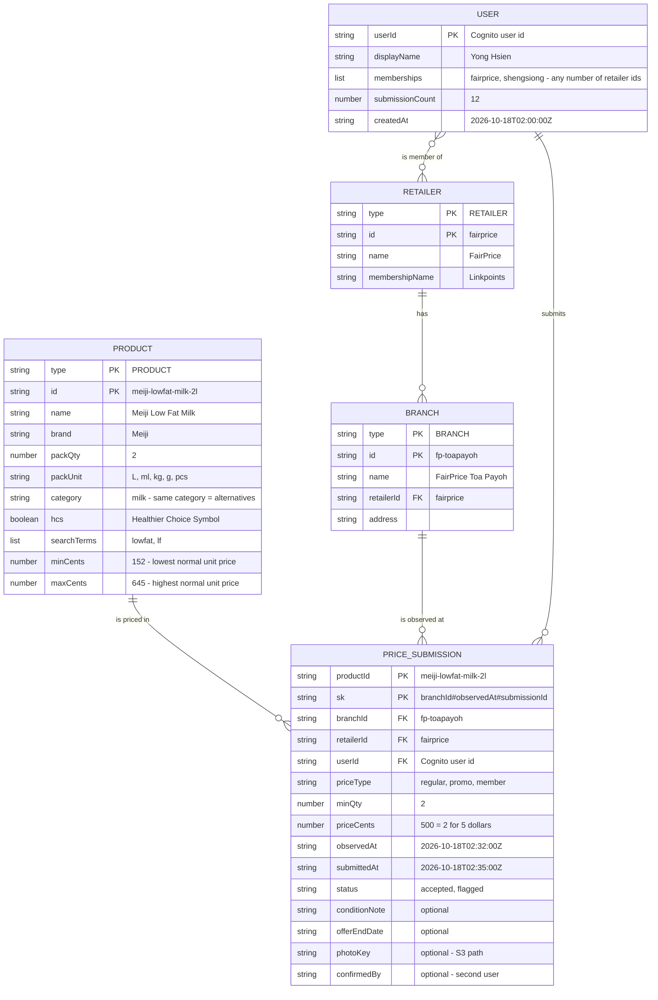
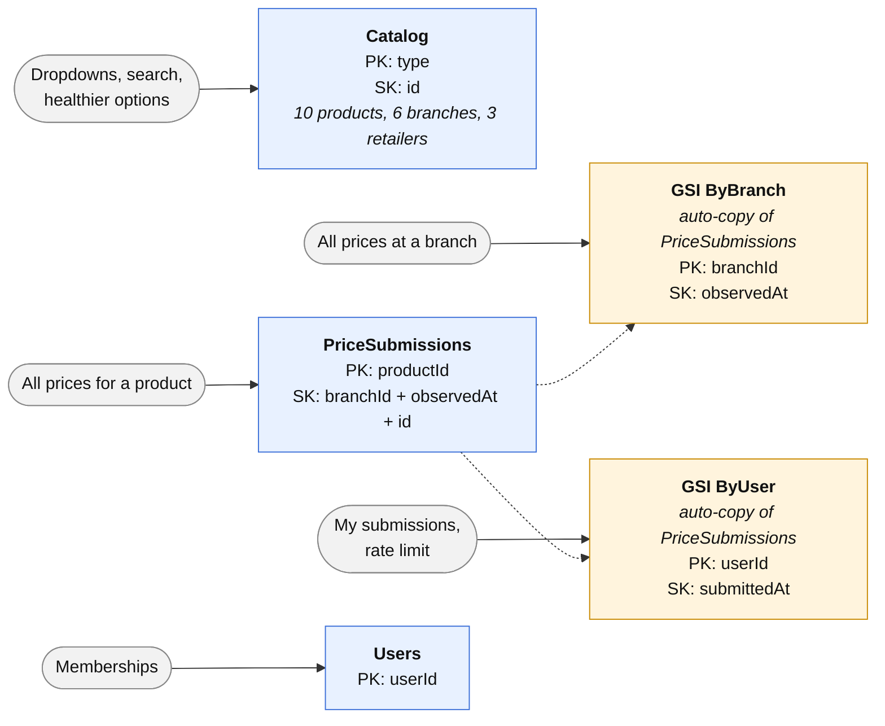

# TrolleySaver Database Design (Draft)

**Owner:** Yong Hsien · **Last updated:** 18 Oct 2026 · **Database:** Amazon DynamoDB

## 1. Entity Relationship Diagram

## 2. DynamoDB Tables and Indexes

**Key:** `PK` = key field · `FK` = refers to another entity · prices are in cents (`395` = $3.95) · `flagged` prices are ignored until a second user submits the same price.
