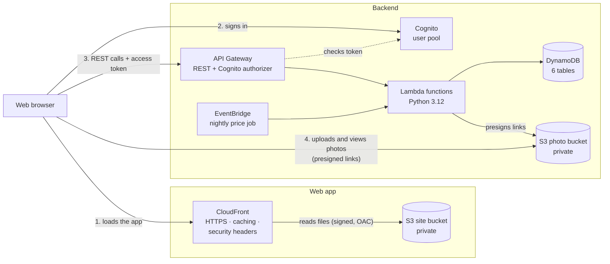
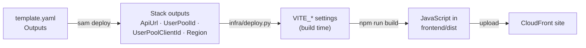

# Deploying TrolleySaver

How TrolleySaver gets from this repository onto AWS: what is deployed, the one command that deploys it, what each step does and why, and how continuous integration checks every change first.

**Last updated:** 6 Nov 2026 · **Environment:** `dev` (stack `trolleysaver-dev`, region `ap-southeast-1`) · **Site:** https://d2xn4fxnysvlr5.cloudfront.net

| Looking for | Go to |
|---|---|
| Deploy now | [3. Deploying](#3-deploying) |
| What runs where | [1. What gets deployed](#1-what-gets-deployed) |
| First time on this machine | [2. One-time setup](#2-one-time-setup) |
| Something failed | [7. Rolling back and troubleshooting](#7-rolling-back-and-troubleshooting) |

---

## 1. What gets deployed

Everything is described in one AWS SAM template, [backend/template.yaml](../backend/template.yaml), and deployed as one CloudFormation stack. The same template can create another environment (e.g. staging) by changing its name.



| Part | AWS service | What it does |
|---|---|---|
| Web app | S3 + CloudFront | The React app is built into static files (`frontend/dist`) and stored in a **private** bucket. CloudFront serves it over HTTPS from edge locations near Singapore. It is the only thing allowed to read the bucket ([Origin Access Control](#why-origin-access-control)). |
| Sign-in | Cognito user pool | Accounts, passwords and the `user` / `admin` groups. The browser talks to it directly through Amplify. |
| API | API Gateway (REST) | The public HTTPS API. A Cognito authorizer rejects requests without a valid access token on every signed-in route. |
| Logic | 12 Lambda functions | One per area (catalog, search, basket, submissions, moderation, product requests, the nightly price job, the two Cognito triggers). |
| Data | DynamoDB (6 tables) | Products, retailers, users, price submissions, daily prices and product requests. On `dev` the tables were created by hand and the stack only uses them (`CreateTables=false`). |
| Photos | S3, private | Evidence photos and product pictures, only reachable through short-lived presigned links. |

The deployed web app always runs against the real backend: it is built with Cognito sign-in and API mode, whatever a developer's `frontend/.env.local` says.

## 2. One-time setup

On the machine that deploys (Windows, macOS or Linux):

| Tool | Install | Check |
|---|---|---|
| Python 3.11 or later | python.org | `python --version` |
| AWS CLI v2 | aws.amazon.com/cli | `aws --version` |
| AWS SAM CLI | `winget install Amazon.SAM-CLI` (Windows) | `sam --version` |
| Node.js 22 or later | nodejs.org | `npm --version` |
| Backend test environment | from `backend/`: `python -m venv .venv`, then `.venv\Scripts\python -m pip install -r requirements-dev.txt` | `backend/.venv` exists |

**Signing in to AWS.** The team account gives each member temporary keys through the AWS access portal:

1. Sign in to the AWS access portal and open **Access keys** for the team account.
2. Copy **Option 2** (the credentials-file block) into `%USERPROFILE%\.aws\credentials`, under the profile name you pass to the deploy script with `--profile`.
3. Confirm who you are:

```powershell
aws sts get-caller-identity --profile <your profile> --region ap-southeast-1
```

The keys last a few hours. When a command says the token has expired, copy fresh ones from the portal. `aws sso login` only works for a profile set up with `aws configure sso`; a profile holding pasted keys has no SSO settings, so that command fails.

**A brand-new environment** also needs its data. A redeploy of `dev` doesn't need this:
- Load the catalog with `backend/scripts/seed_catalog.py`.
- Create admin accounts with `backend/scripts/create_admin.py`.
- Run the price job once ([backend/TESTING.md](../backend/TESTING.md)).

## 3. Deploying

From the repository root:

```powershell
python infra\deploy.py --profile <your SSO profile>
```

That's the whole deployment. It stops at the first problem and says what to do. A full run takes about **10 minutes**. The run on 6 Nov 2026 that first created the CloudFront distribution took 10 min 02 s, including about 4 minutes of installing packages and running the tests. It ended with all 64 smoke checks passing.

| Option | Use it to |
|---|---|
| `--skip-tests` | Skip step 2, e.g. right after a green CI run on the same commit |
| `--backend-only` | Deploy the stack but not the web app |
| `--frontend-only` | Rebuild and upload only the web app (much faster; the stack must already exist) |
| `--smoke` | Finish with the end-to-end smoke test: 71 checks against the live API, cleaning up after itself |
| `--env staging` | Deploy another environment (needs a `[staging.*]` section in `backend/samconfig.toml`) |

### What each step does, and why

| # | Step | What happens | Why |
|---|---|---|---|
| 1 | **Preflight** | Checks the tools are installed. Shows the account and role you're signed in as. Checks the stack's photo bucket is visible, and that CloudFront is available. | Deploying to the wrong account, or with an expired login, fails here in seconds instead of halfway through. |
| 2 | **Tests** | `npm ci`, then [tests/run_all.py](../tests/run_all.py): the backend unit tests (pytest, with AWS faked by moto), the frontend tests (Vitest) and the template lint. | A failing test never reaches users. |
| 3 | **Backend** | `sam validate --lint`, then `sam deploy --config-env dev`. SAM zips `backend/lambdas/` and uploads it, then CloudFormation works out what changed and updates only that. | If anything fails, CloudFormation **rolls the whole stack back** to the last good version automatically. |
| 4 | **Stack outputs** | Reads the stack's outputs: the API URL, Cognito ids, site bucket, CloudFront distribution and site URL. | The frontend's settings come from the stack itself, so they can't drift out of date or be mistyped. |
| 5 | **Build** | `npm run build`, with `VITE_AUTH_MODE=cognito`, `VITE_PRICE_SUBMISSION_MODE=api`, `VITE_SMART_BASKET_MODE=api`, and the API URL and Cognito ids from step 4. | Vite writes these values into the JavaScript at build time. They aren't secrets: every visitor's browser receives them. |
| 6 | **Upload** | Copies `frontend/dist` to the site bucket in 3 passes: the new asset files, then `index.html`, then deletes the previous build's files. | See [Caching](#caching). The order means someone loading the site mid-deploy never gets a page whose files are already gone. |
| 7 | **Invalidate** | Asks CloudFront to drop its cached copies (`/*`) and waits until it has. | Visitors get the new version on their next page load, not when the cache expires. |
| 8 | **Check** | Fetches the site, `/search` and `/contribute`, and checks each returns the app. With `--smoke`, also runs the smoke test. | Proves the site is reachable and that reloading a deep link works. |

### Caching

- **Asset files** (`assets/index-3f9a1c.js` and so on) have a hash of their content in their name. A change to the code means a new file name, so they are cached for a year (`Cache-Control: public, max-age=31536000, immutable`).
- **`index.html`** is never cached (`Cache-Control: no-cache`). It's the only file whose name doesn't change, and it points at the current asset files. A normal reload therefore always picks up a new deploy.

### Pages other than the home page

The app decides which page to show in the browser (`/basket`, `/search`, `/contribute`), and none of those paths is a file in the bucket. CloudFront is set to answer a missing file with `index.html` and status 200. The app then loads and shows the right page, so bookmarks and reloads work.

### Why Origin Access Control

The site bucket blocks all public access. CloudFront signs each request to it, and the bucket policy only accepts requests from this one distribution. Visitors can only reach the files through CloudFront's HTTPS URL, which also adds the [security headers](#security-headers).

### Security headers

CloudFront adds these to every file it serves. They are set by `FrontendSecurityHeaders` in [backend/template.yaml](../backend/template.yaml), and step 8 of the deploy fails if the Content-Security-Policy is missing.

| Header | Value | What it does |
|---|---|---|
| `Content-Security-Policy` | see below | Says where the app may load code, styles, images and fonts from, and which servers it may talk to. Script injected into a page can't run, and data can't be sent anywhere else. |
| `Strict-Transport-Security` | `max-age=31536000` | Browsers use only HTTPS for the site for a year |
| `X-Content-Type-Options` | `nosniff` | Browsers treat each file as the type it says it is |
| `X-Frame-Options` | `DENY` | Other sites can't show the app inside a frame (clickjacking) |
| `Referrer-Policy` | `strict-origin-when-cross-origin` | Other sites only see the domain a visitor came from, not the page |
| `Permissions-Policy` | `camera=(), microphone=(), geolocation=(), payment=(), usb=()` | The app uses none of these features, so nothing in it may |
| `Cross-Origin-Opener-Policy` | `same-origin` | A page opened from another site can't reach into the app's window |

What the Content-Security-Policy allows:

| Directive | Allows | For |
|---|---|---|
| `script-src` | `'self'` | The app's own JavaScript files only: no inline script, no `eval` |
| `style-src` | `'self' 'unsafe-inline'` | The app's CSS, plus the `<style>` tag the toast library adds |
| `img-src` | `'self' data: blob:` and the photo bucket | Icons, the preview of a chosen photo, signed picture links |
| `font-src` | `'self' data:` | The bundled Inter and Nunito fonts |
| `connect-src` | `'self'`, `https://*.execute-api.ap-southeast-1.amazonaws.com`, `https://cognito-idp.ap-southeast-1.amazonaws.com` and the photo bucket | API calls, sign-in, photo uploads |
| `frame-ancestors`, `object-src` | `'none'` | No embedding the app, no plugins |
| `base-uri`, `form-action` | `'self'` | No redirecting relative links or forms elsewhere |

**Adding anything external** means adding its host to the policy in `template.yaml` and deploying the stack. That includes a font or image CDN, analytics, a map, or another API. Otherwise browsers block it, and the console names the directive. `npm run dev` sends no CSP, so check new features on the deployed site.

### Limits on abuse

| What | Limit | Where |
|---|---|---|
| API requests, all callers together | 20 a second, bursts of 40; then `429` | `MethodSettings` on `Api` in `template.yaml` |
| Price submissions | 30 per user per hour | `RATE_LIMIT_PER_HOUR` |
| Product requests | 10 per user per day | `PRODUCT_REQUESTS_PER_DAY` |
| Photo upload links | 60 per user per hour, price photos and product requests together | `UPLOAD_LINKS_PER_HOUR` |

Other protections:
- **Uploads:** S3 enforces each file's type and size. The backend then checks the file's first bytes really are a JPG or PNG, and deletes it if not. The browser redraws every photo before upload, which drops its metadata, such as the GPS location phones record.
- **Text:** names, brands, categories, tags, search terms and reasons can't contain hidden characters, such as a zero-width space or a right-to-left override. The sign-up trigger applies the registration form's name rules, so calling Cognito directly can't skip them.
- **API responses** are sent with `nosniff` and `Cache-Control: no-store`, so nothing keeps a copy of people's data.
- **Backups:** every table has point-in-time recovery: it can be restored to any second in the last 35 days. See [7. Rolling back and troubleshooting](#7-rolling-back-and-troubleshooting).

## 4. How settings reach the frontend



Nothing secret is stored in the frontend, the repository or GitHub. The Cognito app client has no secret, by design for a browser app. Each API request is authorised by the signed-in user's own short-lived access token.

## 5. CORS: which sites may call the API

Browsers only let a web page read an API response from another domain if the API names that page's domain in `Access-Control-Allow-Origin`. Two sites are allowed:
- the local dev server, `http://localhost:5173` (the `AllowedOrigin` template parameter)
- the deployed site, `https://d2xn4fxnysvlr5.cloudfront.net`, which the template takes straight from the CloudFront distribution

How each part enforces it:
- **Every Lambda response** names the caller's origin only if it is one of those two ([backend/lambdas/common/http.py](../backend/lambdas/common/http.py)). A page on any other site can't read the response.
- **The photo bucket** accepts browser uploads from the same two origins.
- **Preflight `OPTIONS` responses and API Gateway's own error responses** (e.g. a 401 from the authorizer) allow any origin. They are fixed responses that can only name one value, and they contain no data.

The API also needs a valid Cognito access token on every signed-in route. Another site can't get one, so CORS is a second layer, not the only protection.

## 6. Continuous integration

[.github/workflows/ci.yml](../.github/workflows/ci.yml) runs on every push and pull request, as three jobs in parallel:

| Job | Runs |
|---|---|
| Backend unit tests | `pytest` on Python 3.12, the Lambda runtime. AWS is faked by moto, so it needs no credentials. |
| Frontend | `npm ci`, `lint`, `typecheck`, `test` and the production `build` |
| Template lint | `cfn-lint backend/template.yaml` (what `sam validate --lint` runs) |

A pull request shows a green tick only when all three pass.

CI doesn't deploy. Deploying needs AWS credentials, and the team account only issues short-lived SSO sessions to people, not to GitHub. So deploying stays a deliberate step: a team member runs `infra/deploy.py` from a commit CI has already passed.

## 7. Rolling back and troubleshooting

**If a deploy fails partway:**
- **Failed backend update:** CloudFormation rolls back by itself, and the API keeps serving the previous version.
- **Failed frontend upload:** the old `index.html` stays in place until the new one is uploaded, so the site keeps working.

**To roll back a release:** check out the previous good commit and deploy again:

```powershell
git checkout <good commit>
python infra\deploy.py --profile <profile> --skip-tests
git checkout -     # back to where you were
```

**Common problems:**

| Message | Fix |
|---|---|
| `Not signed in to AWS` / `ExpiredToken` | Copy fresh keys from the AWS access portal into `%USERPROFILE%\.aws\credentials` (see [2. One-time setup](#2-one-time-setup)), then run the deploy again |
| `Can't see the stack's photo bucket` | You're signed in to the wrong account, or with the wrong profile |
| `` `sam` isn't installed or isn't on PATH `` | Install the SAM CLI, then open a **new** terminal so PATH updates |
| `backend/.venv is missing` | Set it up ([2. One-time setup](#2-one-time-setup)), or pass `--skip-tests` |
| A test fails in step 2 | Fix it. The output above the summary shows which. `python tests\run_all.py` reruns just the tests. |
| `The stack has no SiteUrl output yet` | Run once without `--frontend-only`, so the stack creates the site |
| The site shows an old version | Reload normally. If it persists, check step 7 finished, and look in the browser's developer tools for errors. |
| A CORS error in the browser console | Check the page's address is one of the [two allowed origins](#5-cors-which-sites-may-call-the-api) |
| `Refused to load` / `Refused to connect` (Content-Security-Policy) in the browser console | The page used a host the policy doesn't list. Add it to `FrontendSecurityHeaders` in `template.yaml` ([Security headers](#security-headers)), then deploy the stack. |
| `429` / `Too Many Requests` | Over the [API throttle](#limits-on-abuse), or a person's upload-link limit. Wait and retry. |

**To restore a table** after data is deleted by mistake, restore it to a new table as it was at a moment in the last 35 days, then copy back what's missing:

```powershell
aws dynamodb restore-table-to-point-in-time --source-table-name trolleysaver-dev-price-submission --target-table-name trolleysaver-dev-price-submission-restored --restore-date-time 2026-11-06T09:00:00Z
```

**To tear the stack down:**
1. Empty the site and photo buckets: `aws s3 rm s3://<bucket> --recursive`.
2. Run `sam delete --stack-name trolleysaver-dev` from `backend/`. The `dev` tables are kept, because the stack doesn't own them.

## 8. Known limitations

These are known and accepted for this project.

- **Email addresses aren't verified.** Sign-up auto-confirms accounts (a team decision: no verification codes). Anyone can register with any address.
- **Abandoned uploads.** When a submission fails after its photo was uploaded, the photo stays in the bucket with nothing pointing to it. There's no automatic clean-up, because a blanket expiry rule could delete evidence that's still in use. The upload-link limit (60 per user per hour) caps how fast this can grow.
- **Security measures not in place**, because of cost or the work involved:
  - **Per-visitor rate limiting** (AWS WAF, about US$6 a month or more). The API throttle is shared by everyone, so one heavy caller can slow the API for others.
  - **Cognito threat protection** (compromised-password and unusual sign-in checks; a paid tier).
  - **MFA for admin accounts.** It needs new sign-in screens.
  - **A CAPTCHA on sign-up.** It needs a third-party service.
  - **Sign-in tokens are kept in `localStorage`** (Amplify's default), so a session survives closing the tab. The Content-Security-Policy is what stops injected script from reading them.
- **Duplicate check race.** Two people proposing the same product at the same instant could both pass the "already proposed" check. This is unlikely at this scale, and an admin would see both.
- **Products priced at only some stores** are supported. The Smart Basket lists them as unpriced at the other stores, ranks stores that price everything first, and compares savings only on items both stores price.

  A missing price can mean "not stocked" or "nobody has priced it yet", and the app can't tell which. Splitting a basket across several stores is out of scope.
- **One environment.** The deployed site and all testing share `dev`. The template supports a separate stack (`--env staging` with `CreateTables=true`) if the team needs one.
