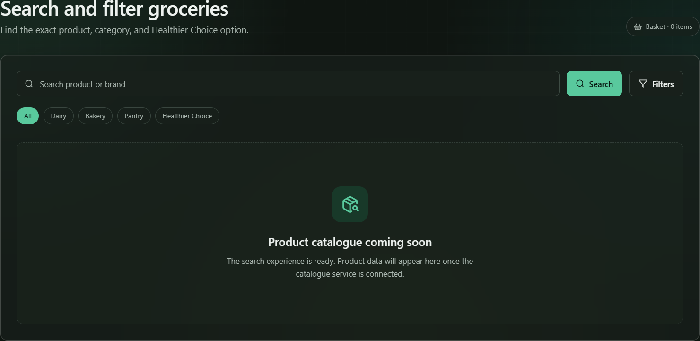
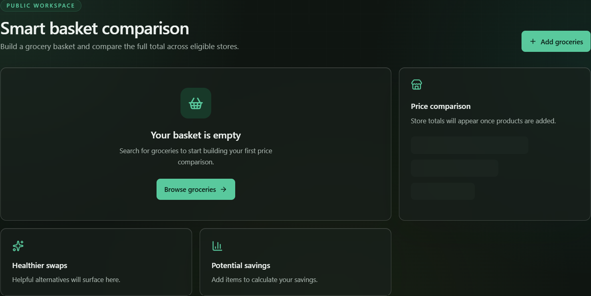

# TrolleySaver UX references

The interactive HTML wireframe remains the primary design source:

- [`trolleysaver-four-wireframes.html`](./trolleysaver-four-wireframes.html)

Use the following captured screens as supporting visual references when implementing the currently empty feature routes. They preserve the intended dark-green palette, restrained glass surfaces, aurora background, spacing, and bento-style hierarchy.

## Search and filter

## Smart basket

These captures document direction, not completed functionality. Refer back to the HTML wireframe for interaction details and responsive behaviour.
